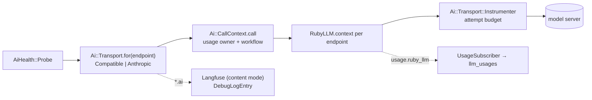
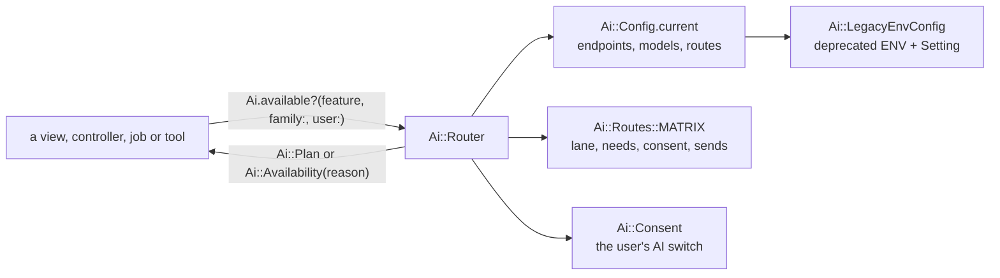
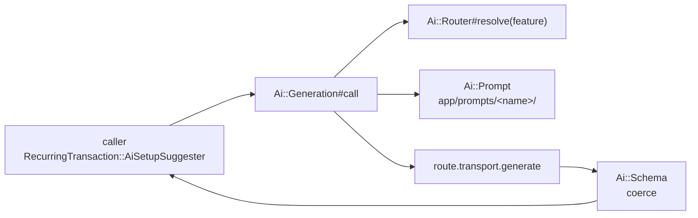

# AI pipeline

Sure's AI calls go through thin transports over RubyLLM. The design is in the v0.8 AI plumbing
proposal (#4440, `docs/proposals/v0.8/ai-plumbing-redesign.md` on that branch).

## Transports and instrumentation

**Where things live**

| Concern | File |
|---|---|
| Endpoint and model values a transport takes | `app/models/ai/config/endpoint.rb`, `model.rb` |
| Every HTTP client, the proxy resolver, the base URL rule | `app/models/ai/transport/http.rb` |
| The transports | `app/models/ai/transport/{base,compatible,anthropic,ruby_llm_adapter}.rb` |
| Errors | `app/models/ai/error.rb` |
| Token counts and cost | `app/models/ai/tokens.rb` |
| Usage owner, workflow and attempt budget around a call | `app/models/ai/call_context.rb`, `transport/instrumenter.rb` |
| Usage rows, the debug log, tracing modes, secret scrubbing | `app/models/ai/instrumentation/*` |

**Rules**

- **A transport never reads ENV, `Setting` or ActiveRecord.** It takes an `Ai::Config::Endpoint`
  and an `Ai::Config::Model`, built by its caller.
- **Build clients only in `Ai::Transport::Http`.** It applies the endpoint's timeout and
  headers, TLS options and the proxy. RubyLLM builds its own connections and takes no TLS
  options, so its contexts use `Http.ruby_llm_adapter`, a Net::HTTP adapter that adds them. The
  contract test fails on `OpenAI::Client.new`, `Anthropic::Client.new` or `Faraday.new`
  anywhere else under `app/models/ai/`.
- **Use RubyLLM's public API only**: `RubyLLM.context`, `Context#chat`/`#embed`,
  `Chat#generate`, the `with_*` setters (`with_instructions`, `with_schema`, `with_thinking`,
  `with_provider_options` among them), `RubyLLM::Tool`, `RubyLLM.workflow`, `RubyLLM.with_owner`,
  `RubyLLM.render_prompt`, `RubyLLM::OpenTelemetry.enable`. Nothing marked `:nodoc:`.
  `test/architecture/ai_transport_contract_test.rb` lists the surface Sure uses.
- **RubyLLM never retries.** Every context has `max_retries = 0`; `Ai::Transport::Base#attempt`
  retries rate limits, 5xx and timeouts up to the endpoint's `max_retries`. RubyLLM retries
  inside one request with no hook before a retry, so only Sure can stop on a spent balance and
  check the time budget between tries.
- **Raise only `Ai::Error`.** Map client errors in the transport (`mapping_errors`). Mapped
  messages are scrubbed of the endpoint's secrets (`Endpoint#secrets`: the key and long static
  header values) before anything logs them.
- **Wrap every call in `Ai::CallContext.call`.** RubyLLM's `usage.ruby_llm` event then carries
  the family (the usage owner) and the call (the workflow), and `UsageSubscriber` writes one
  `llm_usages` row per request. A failed request's row takes its own error from the
  `request.ruby_llm` event (`Ai::Transport::Instrumenter`). The call's `.ai` event then attaches
  any error not yet recorded, and writes why the answer stopped (`llm_usages.finish_reason`) on
  the answering request's row.
- **Never create `ruby_llm_usages`.** RubyLLM's ledger would then record every call a second time.

**Tests**

- `test/support/ai_test_helper.rb`: `ai_endpoint`, `ai_model`, `with_ai_call_context` and
  `capture_ai_events`.
- A new transport, or a new transport call, passes `ai_transport_contract_test.rb`: every HTTP
  status maps onto `Ai::Error`, retries follow the endpoint, usage counts cached tokens, and the
  proxy is resolved by `Http`.

## Routing and consent

**Where things live**

| Concern | File |
|---|---|
| The routing table: each feature's lane, needs, consent level and data sent | `app/models/ai/routes.rb`, descriptions in `config/locales/models/ai/en.yml` |
| What may run for a feature, family and user, or why not | `app/models/ai/router.rb`, `ai.rb` (`Ai.available?`, `Ai.availability`, `Ai.plan`) |
| Consent | `app/models/ai/consent.rb` |
| The configuration snapshot and its routes | `app/models/ai/config.rb`, `route.rb` |
| The deprecated AI ENV and `Setting` fields, read as configuration | `app/models/ai/legacy_env_config.rb` |
| The controller guard | `app/controllers/concerns/ai_feature_guard.rb` (`requires_ai`) |
| The family's AI settings | `app/models/family/ai_settings.rb` |

**Rules**

- **Ask the router, never a provider.** Show an AI affordance with
  `ai_feature_available?(:feature)` in a view, guard an action with `requires_ai :feature`, and
  check `Ai.available?(:feature, family:, user:)` in a model or job. Don't test
  `Provider::Registry`, `Setting` or `VectorStore` for availability.
- **No AI ENV.** The cop `Sure/NoAiEnv` flags `ENV` reads of AI-looking names outside
  `Ai::LegacyEnvConfig`; read AI configuration through `Ai::Config` instead. The files on its
  allowlist in `.rubocop.yml` still read ENV; the list only shrinks.
- **A new feature is a row in `Ai::Routes::MATRIX`**, with `sends:` keys described in
  `config/locales/models/ai/en.yml`, and its key is permanent once released. Regenerate the table
  below with `bin/rails ai:routes_doc`; `ai_routing_matrix_test` fails when it's stale.
- **Consent:** chat and bills need the user's own AI switch (`users.ai_enabled`); nothing else
  needs consent yet.
- **An AI tool declares its feature** (`ai_feature :extract_pdf` on an `Assistant::Function`), so
  chat and MCP list it only while the feature is available.
- **`Ai::Config` is built in each process from its own ENV**, so give the web and the worker
  containers the same AI variables.

<!-- ai:routes_doc -->
| Feature | Lane | Needs | Consent row | Sends |
|---|---|---|---|---|
| `chat` | interactive | tools, streaming | Chat (user) | Your chat messages; The financial data the assistant looks up to answer; The text of statements stored in your vault |
| `bill_setup` | interactive | structured_output | Bills (user) | Transaction dates; Transaction amounts; Transaction names; Your category names; The bill's current settings |
| `extract_pdf` | prompt | structured_output | PDF import (user) | The document you upload |
| `embed` | prompt | embedding | Documents (user) | Your uploaded documents, as whole files to a vector store or as text chunks to an embedding model |
| `search_documents` | interactive | embedding | Documents (user) | Your search text |
| `categorize` | background | generation: structured_output; judgement: judge | Categories (family) | Transaction names; Transaction amounts; Categories your bank suggests; Your category names |
| `shadow_categorize` | background | generation: structured_output; judgement: judge | Categories (shadow runs) (family) | Transaction names; Transaction amounts; Categories your bank suggests; Your category names |
| `detect_merchants` | background | structured_output | Merchants (family) | Transaction names; Merchant names |
| `enhance_merchants` | background | structured_output | Merchants (family) | Merchant names |
<!-- /ai:routes_doc -->

**Tests**

- `use_ai_routes(categorize: %w[gpu/qwen3-8b openai/gpt-4.1-mini])` routes the rest of the test
  through the test setup (`AiTestHelper.test_config`), the named features' routes replaced;
  `use_no_ai` configures nothing.
- `test/architecture/ai_agreement_test.rb` asks every entry point in each setup the provider code
  supports (`test/support/ai_legacy_setups.rb`) and fails when one disagrees with the router.
  Chat's entry points are on its allowlist, as chat doesn't go through the router yet.
- `ai_config_test.rb` checks that the deprecated ENV path routes each feature to the provider and
  model the provider code uses; `ai_feature_guard_test.rb` that every action starting an AI feature
  declares `requires_ai`.

## Generations

A structured-output feature is one small `Ai::Generation` file and a prompt folder; routing,
failover, the JSON mode and parsing are the plumbing's. Bill setup is the first feature on it
(`RecurringTransaction::AiSetupSuggester` calls `Ai::Generations::SuggestBillSetup` on the web
thread). Categorization, merchant detection and enhancement, and PDF import still run on their
provider classes until their own releases.

**Where things live**

| Concern | File |
|---|---|
| A feature's declaration: key, prompt, schema, batching | `app/models/ai/generations/*.rb`, on `app/models/ai/generation.rb` |
| Its prompts, one folder per variant | `app/prompts/<name>/instructions.txt.erb` and `input.txt.erb`; shared parts in `app/prompts/shared/` |
| Which folder a route runs | `Ai::LegacyEnvConfig.prompt_for` (`<name>` on OpenAI-compatible endpoints, `<name>_anthropic` on Anthropic) |
| JSON modes and tolerant parsing | `app/models/ai/transport/json_mode.rb`, `base.rb` |
| Coercion | `app/models/ai/schema.rb` |
| The call's result | `app/models/ai/result.rb` |
| Batches, splitting and down marks, for the batched features to come | `app/models/ai/batch.rb`, `generation.rb`, `down_marks.rb` |

**Adding a generation feature**

1. Add its row to `Ai::Routes::MATRIX` (see above), and its prompt folder name to
   `Ai::LegacyEnvConfig::PROMPTS`.
2. Write `app/models/ai/generations/<name>.rb`: `feature`, `prompt`, `schema` (a constant or a
   method, valid in OpenAI's strict mode), and for a list `batch`, `merge … by:`, `required` and
   `blank_item`. `prompt_locals` gives the templates their data.
3. Write the prompt folders. RubyLLM renders them with ERB trim mode `-`, so end a file's last
   tag with `-%>` when the text must not end in a newline, and check the rendered text against the
   golden file.
4. Call it: `.call` returns an `Ai::Result` (`success?`, `value`, `unavailable?`, `error`) and never
   raises an `Ai::Error`; `.call!` returns the value or raises.
5. Add `test/models/ai/generations/<name>_test.rb`; `ai_routing_matrix_test`, `ai_schemas_test`
   and `ai_prompts_test` check the rest.

**Rules**

- **One schema, every transport.** The schema goes through RubyLLM's `with_schema`: a strict
  `response_format` on chat completions and the Responses API, native structured output on
  Anthropic. Anthropic refuses numeric limits (`minimum`, `maximum`) and an `enum` on a field
  typed `[x, "null"]`, so its transport moves the limits into the field's description and sends a
  nullable enum as `anyOf` its values and null; `Ai::Schema` still checks the answer against the
  feature's own schema.
- **JSON modes** apply to chat-completions servers (the endpoint's `json_mode`, from
  `LLM_JSON_MODE`). `auto` walks strict, json_object, none: it moves on when the answer doesn't
  parse or, for a list, when more than half the items are blank, and when the server answers 400
  to the format. A 400 to a request that sent a reasoning effort is retried without it. Any other
  400 ends the call. An explicit mode stays, apart from one retry in `none`.
- **One route per feature today.** `Ai::LegacyEnvConfig` lists bill setup on the provider
  `LLM_PROVIDER` picks, as before, so failover, escalation and bisection don't run in production
  yet. Bill setup calls with `down_marks: false`: with one route and a person waiting, a down mark
  would fail every click for a minute.
- **A caller turns failures into its own error.** `AiSetupSuggester` raises its `Error` for an
  unavailable feature, a failed result, and any other exception, so the dialogs show "Could not
  analyze the charge history" instead of a 500.
- **Prompts change only with evals.** `test/architecture/ai_prompts_test.rb` renders each prompt
  folder against its golden text in `test/fixtures/files/ai_prompts/`, captured from the
  per-provider workers the prompts came from.

**Tests**

- `stub_ai(:bill_setup, returns: { ... })` answers the feature's generations without HTTP, still
  running coercion, failover and instrumentation; it returns the requests sent.
  `raises: Ai::Error::Timeout` fails them; a block answers per request.
- `AiTestGeneration` (`test/support/ai_test_generation.rb`) is a batched test generation for the
  core's batching, escalation and bisection tests.
- `test/models/ai/live/` replays cassettes with `with_ai_cassette(preset, name)` under
  `test/vcr_cassettes/ai/<preset>/`; record them with `RECORD_CASSETTES=1` and the keys in ENV,
  or run them live with `AI_LIVE=1`. Remove account identifiers and cookies from a new cassette
  before committing it.
